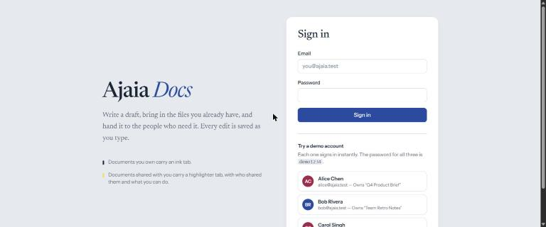
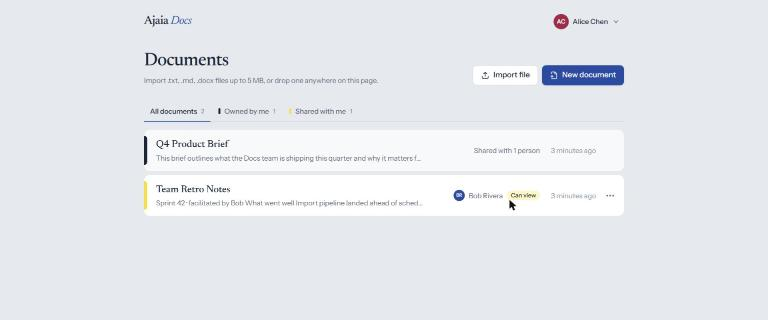
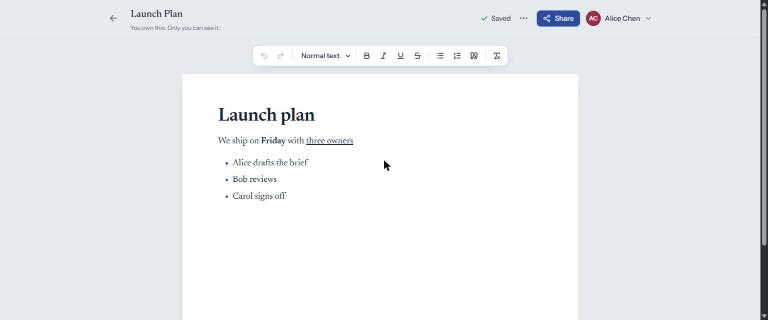
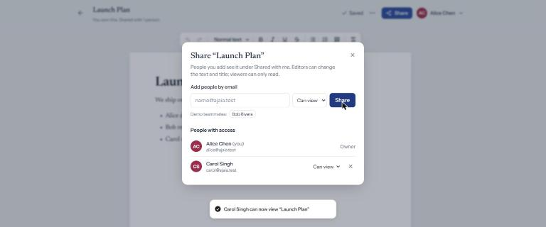
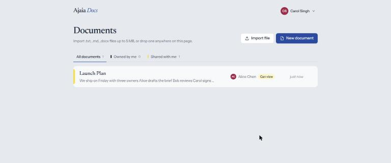
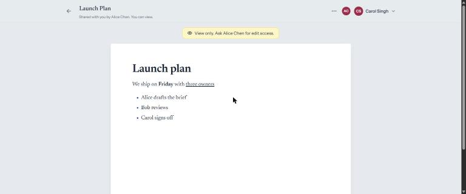
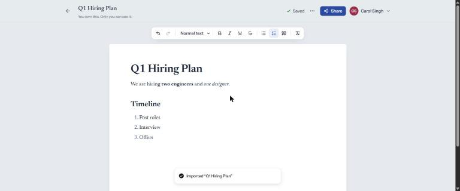

# Ajaia Docs

A lightweight collaborative document editor: create, format, import and share documents, with autosave and clear ownership.

| | |
|---|---|
| **Live app** | https://ajaia-docs-web-9lts.onrender.com |
| **API** | https://ajaia-docs-api-h888.onrender.com/api/health |
| **Stack** | React 19 + Vite + TipTap (ProseMirror) · Express 5 + Drizzle ORM · PostgreSQL (Neon) · Render |

> **First load can take up to ~1 minute.** The API runs on Render's free tier, which sleeps after 15 idle minutes. The app shows a "Starting the server" banner while it wakes, then it is fast.

---

## Demo accounts (for reviewing sharing)

All passwords are `demo1234`. The login page also has one-click buttons for each account.

| User | Email | Starts with |
|---|---|---|
| Alice Chen | `alice@ajaia.test` | Owns **Q4 Product Brief** (shared with Bob as *editor*). Bob's **Team Retro Notes** is shared with her as *viewer*. |
| Bob Rivera | `bob@ajaia.test` | Owns **Team Retro Notes**. Can edit Alice's brief. |
| Carol Singh | `carol@ajaia.test` | Nothing. Use her to test granting access live. |

### 2-minute review path
1. Sign in as **Alice**. The dashboard separates **Owned by me** (ink tab) from **Shared with me** (highlighter tab, sharer and role shown).
2. **New document**: type, use the toolbar (bold, italic, underline, strike, H1–H3, bullet and numbered lists, quote) and rename it inline. The status changes to "Saved". Refresh: content and formatting persist.
3. **Import file**: upload a `.txt`, `.md` or `.docx` (≤ 5 MB), or drag one onto the dashboard. It becomes a new editable doc.
4. Open a doc → **Share** → add `carol@ajaia.test` as **Can view**.
5. Account menu → **Switch account** → **Carol**. The doc is under *Shared with me*. Opening it shows **View only** (no toolbar). The API also rejects edits with 403.
6. As Alice, change Carol to **Can edit**. Carol can now edit. Remove her and she loses access (404).

---

## Screenshots

| | |
|---|---|
| Login with one-click demo accounts |  |
| Dashboard: ink tab = owned, highlighter tab = shared (with sharer + role) |  |
| Editor: formatting, inline title, autosave status |  |
| Share dialog: add by email, viewer/editor roles, revoke |  |
| Carol sees the doc under Shared with me |  |
| Viewer mode: read-only, no toolbar (API also returns 403) |  |
| Markdown import becomes a structured document |  |

---

## Features

| Area | What works |
|---|---|
| **Documents** | Create, rename (inline or from the list), edit, delete (owner, with confirmation), reopen. Autosaves 800 ms after typing stops. Ctrl/Cmd+S saves immediately. |
| **Rich text** | Bold, italic, underline, strikethrough, headings 1–3, bulleted and numbered lists, block quotes, undo/redo, clear formatting, keyboard shortcuts, word count |
| **File import** | **Supported: `.txt`, `.md` / `.markdown`, `.docx`, up to 5 MB.** Each import creates a new document. Headings, bold, italic, underline and lists are preserved. Images and tables in .docx are dropped. Other types are rejected with a clear message (UI and HTTP 415). |
| **Sharing** | Owner shares by email with **Can view** or **Can edit**, changes roles, revokes access. Collaborators can remove a shared doc from their list. Owned and shared docs are visually distinct everywhere. |
| **Access control** | Enforced on the server by a single policy module. No access gives 404 (existence is not leaked). Insufficient role gives 403. |
| **Concurrency** | Optimistic versioning: if two editors save over each other, the second gets a conflict banner (*Load their version* / *Keep mine*) instead of silently losing work |
| **Export** *(stretch)* | Download as Markdown, and Print / Save as PDF with a print stylesheet |
| **Resilience** | Offline/5xx saves retry with backoff. Unsaved-changes guard on tab close. Cold-start banner. A session survives server restarts. |

---

## Run locally

**Requirements:** Node.js 22+ and npm. **No database setup needed.** Without `DATABASE_URL`, the API uses an embedded Postgres (PGlite) stored in `apps/api/.data/`.

```bash
git clone https://github.com/kasularevanth/ajaia-docs.git
cd ajaia-docs
npm install
cp apps/api/.env.example apps/api/.env     # Windows: copy apps\api\.env.example apps\api\.env
cp apps/web/.env.example apps/web/.env
npm run dev
```

- Web: http://localhost:5173
- API: http://localhost:4000/api/health

Demo users and sample documents are seeded automatically on first boot.

### Useful scripts (from the repo root)

| Command | What it does |
|---|---|
| `npm run dev` | API (tsx watch) and web (Vite) together |
| `npm test` | API test suite: Vitest + Supertest against in-memory Postgres (no Docker) |
| `npm run typecheck` | TypeScript across shared, api and web |
| `npm run build` | Production builds (tsup for the API, Vite for the web) |
| `npm run db:generate` | Generate a SQL migration after editing `apps/api/src/db/schema.ts` |

To run locally against real Postgres, set `DATABASE_URL` in `apps/api/.env` (for example a Neon branch).

---

## Environment variables

### API (`apps/api/.env`, or the Render dashboard)
| Variable | Required | Default | Notes |
|---|---|---|---|
| `DATABASE_URL` | prod | *(empty → PGlite)* | Neon **pooled** connection string with `?sslmode=require` |
| `JWT_SECRET` | ✅ | — | ≥ 16 chars. `render.yaml` generates one. |
| `CORS_ORIGINS` | ✅ | `http://localhost:5173` | Comma-separated frontend origins |
| `NODE_ENV` | | `development` | `production` on Render |
| `PORT` | | `4000` | Render injects its own |
| `JWT_EXPIRES_IN` | | `7d` | |
| `MAX_UPLOAD_MB` | | `5` | Import size limit |
| `SEED_DEMO_DATA` | | `true` | Idempotent seed of demo users and docs at boot |
| `DEMO_PASSWORD` | | `demo1234` | |
| `BCRYPT_ROUNDS` | | `10` | |
| `LOG_LEVEL` | | `info` | |

### Web (`apps/web/.env`; production value committed in `apps/web/.env.production`)
| Variable | Notes |
|---|---|
| `VITE_API_URL` | API base URL, baked in at build time (public, not a secret) |

---

## Deployment (Render, free tier)

`render.yaml` is a Render **Blueprint** that defines both services:
- **ajaia-docs-api**: Web Service (Node 22). The build bundles with tsup. At start it runs migrations and the idempotent seed, then listens. Health check is `/api/health`.
- **ajaia-docs-web**: Static Site (Vite build) with an SPA rewrite and security headers.
- **Database**: Neon Postgres (free, no expiry). It's used instead of Render's free Postgres, which expires after 30 days.

Steps: Render → **New → Blueprint** → select the repo → paste `DATABASE_URL` → **Deploy**. Pushes to `main` redeploy automatically. CI (GitHub Actions) runs typecheck, tests and builds on every push.

---

## Project structure

```
apps/api        Express API: auth, documents, sharing, import · Drizzle schema + migrations · tests
apps/web        React SPA: dashboard, editor, share dialog
packages/shared Zod schemas, API types, constants, and the TipTap schema shared by client and server
docs/           Planning and architecture docs (plan, frontend, backend, database, deployment)
```

More detail: [ARCHITECTURE.md](ARCHITECTURE.md) · [AI_WORKFLOW.md](AI_WORKFLOW.md) · [SUBMISSION.md](SUBMISSION.md) · [docs/](docs/)
