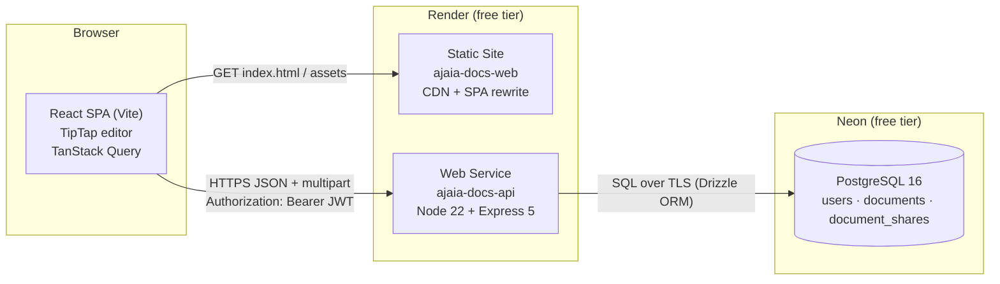
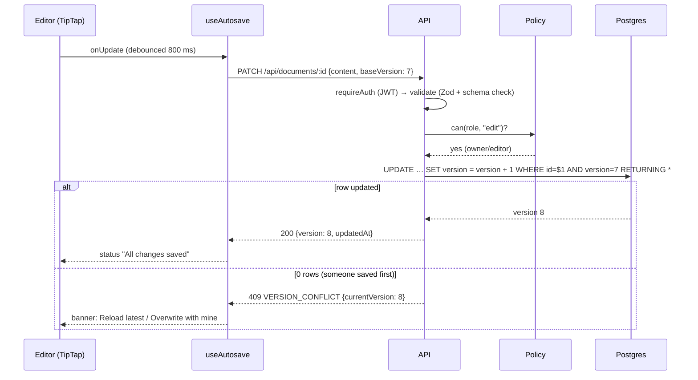

# 01 — Architecture Overview

**Product:** Ajaia Docs, a lightweight collaborative document editor (a Google Docs–style slice)
**Goal:** a small, deep, working product: create, edit, import, share and persist documents, deployed and testable by reviewers.

---

## 1. System at a glance



| Layer | Choice | Why this, under a 4-hour timebox |
|---|---|---|
| Frontend | **React 18 + Vite + TypeScript** | Fast dev server and builds, and the output is a static bundle (fits a Render Static Site). |
| Editor | **TipTap v3 (ProseMirror)** | Schema-based rich text with JSON output. Bold, italic, underline, headings and lists come built in, and it is MIT/free. |
| UI | **Tailwind CSS + Radix primitives + lucide icons + sonner toasts** | Accessible dialogs and menus without building them from scratch, with a consistent look. |
| Server state | **TanStack Query** | Caching, invalidation and loading/error states for free, so there is no hand-written global store. |
| Backend | **Node 22 + Express 5 + TypeScript** | Express 5 forwards async errors to the error handler natively, and the ecosystem is mature (multer, helmet, rate-limit). |
| Validation | **Zod** (shared between client and server) | One schema covers the request body type, runtime validation and form errors. |
| ORM / migrations | **Drizzle ORM + drizzle-kit** | Type-safe SQL with a thin runtime (fast cold starts on a free instance) and plain SQL migration files. |
| Database | **PostgreSQL on Neon (free)** | Real relational integrity for owners and shares, JSONB for document content, no expiry on the free tier. |
| Local / test DB | **PGlite (embedded Postgres in WASM)** | `npm install && npm run dev` works with **zero DB setup**, and tests run real Postgres SQL with no Docker. |
| Auth | **Email + password (bcrypt), JWT bearer token, seeded demo users** | Real authentication, kept small. Seeded users make the sharing flow easy to review. |
| File import | **multer → mammoth (.docx) / marked (.md) / plain (.txt) → sanitized HTML → TipTap JSON** | Product-relevant: turn an existing file into an editable doc. |
| Tests | **Vitest + Supertest + PGlite** | Integration tests through the real HTTP layer and real SQL, covering access control and import. |
| Hosting | **Render Static Site + Render Web Service** via `render.yaml` Blueprint | Free, Git-push deploys, infrastructure-as-code in the repo. |

---

## 2. Key architectural decisions (ADR-lite)

### ADR-1: Canonical document format is TipTap/ProseMirror JSON in a `JSONB` column
- **Decision:** Store `content` as ProseMirror JSON, and also store a derived `content_text` for previews.
- **Why:** The JSON preserves structure exactly (headings, marks, lists). The server can validate it against the same editor schema the client uses, and it never renders raw HTML, which removes a whole class of XSS issues.
- **Rejected:** Storing HTML (needs sanitizing on every read and is harder to validate). Markdown (lossy for underline).

### ADR-2: One shared package for editor schema and contracts
- `packages/shared` exports the **TipTap extension list**, the **Zod schemas** and the **API types**.
- The API uses the same extension list to (a) validate incoming content (`Node.fromJSON(schema, json)`) and (b) convert imported HTML into JSON (`generateJSON`). The editor and the server can never disagree on what a valid document is.

### ADR-3: Bearer JWT instead of cookies
- The static site (`*-web.onrender.com`) and the API (`*-api.onrender.com`) are **different sites**, because `onrender.com` is on the Public Suffix List. Cookies would be third-party and get blocked by Safari ITP and by Chrome's third-party-cookie restrictions.
- So the token is returned in the JSON body, kept in `localStorage`, and sent as `Authorization: Bearer`.
- **Tradeoff (documented):** a token in `localStorage` can be read by XSS. Mitigations: no raw-HTML rendering (ADR-1), `helmet` on the API, security headers on the static site, and a 7-day expiry. With a custom domain we would switch to `HttpOnly; SameSite=Lax` cookies.

### ADR-4: Optimistic concurrency, not real-time co-editing
- Each document has an integer `version`. Saves send `baseVersion`, and the SQL update is `WHERE id = $1 AND version = $2`.
- If someone else saved first, the response is **409 VERSION_CONFLICT**, and the UI offers *Reload latest* or *Overwrite with mine*.
- **Why:** this prevents silent data loss between shared editors at about 5% of the cost of a CRDT/Yjs real-time stack. Real-time editing is an explicit scope cut.

### ADR-5: Authorization in one pure policy module
- `resolveRole(document, userId, share) → 'owner' | 'editor' | 'viewer' | null`
- `can(role, action)` for the actions `read | edit | rename | delete | share`.
- A user with no access gets **404** (the document's existence is not revealed). A user with insufficient rights gets **403**.
- It is pure and table-tested, and every route goes through it.

### ADR-6: Zero-setup local dev with a DB driver switch
- `DATABASE_URL` set → `node-postgres` Pool (Neon in production).
- `DATABASE_URL` empty → **PGlite** file database at `apps/api/.data/` (local dev) or in-memory (tests).
- The same Drizzle schema and the same SQL migrations run in all three.

### ADR-7: Migrations and seeding run at boot (idempotent)
- Render free instances have no persistent disk and no pre-deploy hook, so `server.ts` runs `migrate()` and then `seed()` (inserts with `ON CONFLICT DO NOTHING`) before `listen()`.

### ADR-8: Handle free-tier cold starts in the product
- A Render free web service sleeps after 15 minutes idle, and the first request can take about 30–60 s.
- The SPA pings `/api/health` on load. If the ping is slow it shows: *"Waking up the server (free-tier cold start, up to ~1 min)…"*, so a reviewer never sees a silent spinner.

---

## 3. Repository layout (npm workspaces monorepo)

```
ajaia-docs/
├── apps/
│   ├── api/                      # Express API (Render Web Service)
│   │   ├── src/
│   │   │   ├── app.ts            # createApp(deps) — used by server + tests
│   │   │   ├── server.ts         # boot: env → db → migrate → seed → listen
│   │   │   ├── config/env.ts     # Zod-validated environment
│   │   │   ├── db/               # schema.ts, client.ts, migrate.ts, seed.ts
│   │   │   ├── lib/              # errors.ts, jwt.ts, password.ts, logger.ts
│   │   │   ├── middleware/       # requireAuth, validate, errorHandler, rateLimit
│   │   │   ├── policies/         # documentAccess.ts (pure)
│   │   │   └── modules/
│   │   │       ├── auth/         # routes + service
│   │   │       ├── documents/    # routes + service + repository
│   │   │       ├── sharing/      # routes + service
│   │   │       └── import/       # routes + converters (txt/md/docx)
│   │   ├── drizzle/              # generated SQL migrations (committed)
│   │   └── test/                 # Vitest + Supertest integration tests
│   └── web/                      # React SPA (Render Static Site)
│       └── src/
│           ├── app/              # router, providers, layout
│           ├── lib/              # api client, query client, utils
│           ├── components/ui/    # Button, Dialog, Badge, Spinner, etc.
│           └── features/
│               ├── auth/         # AuthProvider, LoginPage, RequireAuth
│               ├── documents/    # DashboardPage, DocumentList, ImportButton
│               ├── editor/       # EditorPage, Toolbar, TitleInput, SaveStatus, useAutosave
│               └── sharing/      # ShareDialog
├── packages/
│   └── shared/                   # editor extensions, Zod schemas, types, constants
├── docs/                         # these planning/architecture docs
├── render.yaml                   # Render Blueprint (both services)
├── .github/workflows/ci.yml      # typecheck + test
├── README.md · ARCHITECTURE.md · AI_WORKFLOW.md · SUBMISSION.md · VIDEO_URL.txt
└── package.json                  # workspaces + root scripts
```

---

## 4. Request lifecycle (example: autosave)



---

## 5. Non-functional baseline

| Concern | Approach |
|---|---|
| Validation | Zod on every body, query and param, plus a ProseMirror schema check on content. Title 1–200 chars, content ≤ 1 MB. |
| Error shape | Always `{ error: { code, message, details? } }`, with a central error handler and no stack traces in production. |
| Security | bcrypt hashes, JWT HS256 with a secret from env, `helmet`, a CORS allow-list, login rate limiting, upload size and type limits, and parameterized SQL (Drizzle). |
| Observability | `pino-http` structured logs (visible in the Render log stream) and `/api/health` (checks the DB too). |
| Performance | The list endpoint returns summaries only (no content JSON). Indexes on `owner_id`, `(user_id)` in shares, and `updated_at`. |
| Accessibility | Radix dialogs and menus (focus trap, ESC), toolbar buttons with `aria-label` / `aria-pressed`, keyboard shortcuts (Ctrl+B/I/U). |
