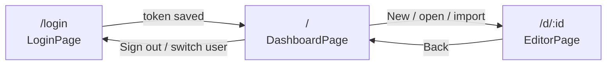

# 02 — Frontend Architecture

**App:** `apps/web`, a React 18 + Vite + TypeScript SPA deployed as a **Render Static Site**.

---

## 1. Stack

| Concern | Library | Notes |
|---|---|---|
| Build / dev | Vite | `VITE_API_URL` is baked in at build time |
| Routing | React Router | `/login`, `/`, `/d/:id` |
| Server state | TanStack Query | Query keys: `['me']`, `['documents', scope]`, `['document', id]`, `['shares', id]` |
| Editor | TipTap v3 (`@tiptap/react`, StarterKit, Placeholder, CharacterCount) | Extension list imported from `@ajaia/shared` |
| Styling | Tailwind CSS | A sheet-style page on a grey canvas, Docs-like |
| Primitives | Radix UI (Dialog, DropdownMenu, Select, Tooltip) | Accessible and keyboard-friendly |
| Icons / toasts | lucide-react, sonner | |
| Forms | Controlled inputs + shared Zod schemas | No form library needed at this size |

---

## 2. Routes and screens



### `/login`: LoginPage
- Email and password form with inline validation and server error display ("Invalid email or password").
- **Demo quick-login buttons**: "Continue as Alice / Bob / Carol". A reviewer can test sharing in about 10 seconds. Credentials are also listed on the page.

### `/`: DashboardPage
- **Header:** app name, "New document" button, "Import file" button, user menu (name, switch user, sign out).
- **Filter tabs:** `All` · `Owned by me` · `Shared with me` (maps to `?scope=all|owned|shared`).
- **Document rows/cards:** title, text preview, updated time ("2 min ago"), and an **ownership badge**:
  - `Owned by you`, plus a "Shared with N" hint
  - `Shared by Alice · Can edit` or `Shared by Alice · View only`
- **Empty states:** "No documents yet — create one or import a .txt, .md or .docx file." / "Nothing shared with you yet."
- **Import:** a hidden `<input type="file" accept=".txt,.md,.markdown,.docx">`. Helper text: **"Supported: .txt, .md, .docx · max 5 MB"**. Type and size are checked on the client first, then the file uploads and the user lands in the new document.
- **Row actions (owner):** Open, Rename, Delete (with a confirm dialog).

### `/d/:id`: EditorPage
```
┌──────────────────────────────────────────────────────────────────────┐
│ ← Docs   [ Q4 Product Brief            ]   ● All changes saved  [Share]│
│          Owned by you  |  Shared by Alice · View only                  │
├──────────────────────────────────────────────────────────────────────┤
│ ↶ ↷ │ [Normal text ▾] │ B  I  U  S │ • List  1. List │ ❝ │ Tx         │
├──────────────────────────────────────────────────────────────────────┤
│                 ┌───────────────────────────────┐                     │
│                 │  (white "page", max-w 816px)   │                     │
│                 │  TipTap EditorContent          │                     │
│                 └───────────────────────────────┘                     │
│                                         1,204 words · Last edited 2m  │
└──────────────────────────────────────────────────────────────────────┘
```
- **TitleInput:** inline, commits on blur or Enter, reverts on Esc. Empty becomes "Untitled document". Max 200 characters.
- **Toolbar:** Undo/Redo · block style (Normal, Heading 1–3) · Bold · Italic · Underline · Strike · Bullet list · Numbered list · Quote · Clear formatting. Each button has `aria-pressed` driven by `editor.isActive()`, read through `useEditorState` so only the toolbar re-renders.
- **SaveStatus:** `Saving…` · `All changes saved` · `Unsaved changes` · `Offline — retrying` · `Couldn't save` (with a retry button).
- **Conflict banner (409):** "This document was changed by someone else." with **Reload latest** and **Overwrite with mine**.
- **Viewer mode:** `editor.setEditable(false)`, toolbar hidden, read-only title, "View only" badge.
- **Share button:** only the owner sees it. Opens ShareDialog.

### ShareDialog (Radix Dialog)
- Email input + role select (`Can view` / `Can edit`) + "Share" button.
- Inline errors: "No user with that email", "You already own this document", "Enter a valid email".
- People with access: the owner row (fixed), then each collaborator with a role dropdown and a remove button.
- Hint: "Demo users: alice@ajaia.test, bob@ajaia.test, carol@ajaia.test".

---

## 3. Module structure

```
apps/web/src/
├── main.tsx                      # ReactDOM root, providers
├── app/
│   ├── router.tsx                # routes + RequireAuth wrapper
│   ├── providers.tsx             # QueryClientProvider, AuthProvider, Toaster
│   └── ServerWakeBanner.tsx      # cold-start UX (pings /api/health)
├── lib/
│   ├── api.ts                    # fetch wrapper: base URL, bearer token, JSON, ApiError
│   ├── queryClient.ts
│   └── format.ts                 # relative time, word count, etc.
├── components/ui/                # Button, IconButton, Input, Dialog, Badge, Spinner, EmptyState
└── features/
    ├── auth/        AuthProvider.tsx · useAuth.ts · LoginPage.tsx · RequireAuth.tsx
    ├── documents/   DashboardPage.tsx · DocumentList.tsx · DocumentRow.tsx · ImportButton.tsx · api.ts (hooks)
    ├── editor/      EditorPage.tsx · Toolbar.tsx · TitleInput.tsx · SaveStatus.tsx · ConflictBanner.tsx · useAutosave.ts
    └── sharing/     ShareDialog.tsx · api.ts (hooks)
```

---

## 4. Data flow and state

| State | Where it lives |
|---|---|
| Auth token and user | `AuthProvider` (React context) with `localStorage['ajaia.token']`. Rehydrated on boot via `GET /api/auth/me`. |
| Documents, shares | TanStack Query cache (server state) |
| Editor content | The TipTap editor instance (source of truth while editing) |
| Save status / version | `useAutosave` hook (local state + refs) |

### API client (`lib/api.ts`)
- Prefixes `import.meta.env.VITE_API_URL`, attaches `Authorization: Bearer <token>`, and parses JSON.
- Non-2xx responses throw `ApiError { status, code, message, details }`, matching the server's error shape.
- A **401** clears the token and redirects to `/login?expired=1`.
- Network failures throw `ApiError { code: 'NETWORK' }`, which drives the "Offline — retrying" state.

### Autosave algorithm (`useAutosave`)
1. The editor's `onUpdate` marks the doc dirty and restarts an **800 ms debounce** timer.
2. When the timer fires: if no save is in flight, `PATCH { content, baseVersion }`. If a save is in flight, set `pendingAfterFlight = true`.
3. On 200: store the new `version` and set the status to `saved`. If `pendingAfterFlight`, save again with the latest content.
4. On 409: stop autosaving and show the ConflictBanner.
   - *Reload latest*: refetch, `editor.commands.setContent(server.content)`, resume.
   - *Overwrite with mine*: refetch the version, then PATCH local content with the fresh `baseVersion`.
5. On network error: exponential backoff retry (1 s, 2 s, 4 s, max 15 s), status `offline`.
6. A `beforeunload` guard runs while dirty or saving, and on unmount the hook flushes with `fetch(..., { keepalive: true })`.

Title rename is a separate small `PATCH { title }`. It is last-write-wins and does not affect content versioning.

---

## 5. UX quality checklist
- [ ] Every async action has loading, success and error states (no silent failures)
- [ ] Toasts for create, import, share, revoke and delete. Inline errors for forms.
- [ ] Keyboard: Ctrl/Cmd+B/I/U, Ctrl+Z/Y, Enter in title commits, Esc closes dialogs
- [ ] Focus lands in the editor body after creating a doc
- [ ] Ownership is visually distinct everywhere (badge + role label)
- [ ] Unsupported file types are explained before upload (helper text + accept filter) and after (error toast)
- [ ] Cold-start banner on a slow first request
- [ ] Responsive down to about 375 px (toolbar wraps; the page sheet becomes full width)

## 6. Explicitly out of scope (frontend)
Real-time cursors and presence, comments and suggestions, tables, images and embeds, print-accurate pagination, offline-first editing, mobile-optimized toolbar UX, and a dark theme.
