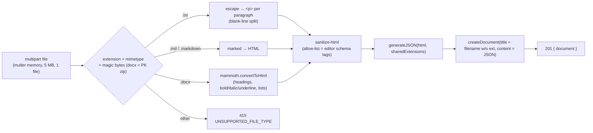

# 03 — Backend Architecture

**App:** `apps/api`, Node 22 + Express 5 + TypeScript, deployed as a **Render Web Service (free)**.

---

## 1. Layering

```
HTTP route (modules/*/routes.ts)
  → middleware: requestId · pino-http · helmet · cors · json(1mb) · requireAuth · validate(zod)
    → service (modules/*/service.ts)      ← business rules, calls policy
      → policy (policies/documentAccess)  ← pure: who can do what
      → repository (modules/*/repo.ts)    ← Drizzle queries only
        → db client (pg Pool | PGlite)
  ← errorHandler → { error: { code, message, details? } }
```

- `createApp({ db, env })` builds the Express app with dependencies injected. `server.ts` and the tests both use it.
- Express 5 forwards rejected promises to the error handler, so there are no `try/catch` wrappers in routes.

## 2. Dependencies

| Purpose | Package |
|---|---|
| HTTP | `express@5`, `cors`, `helmet`, `express-rate-limit` |
| Logging | `pino`, `pino-http` |
| Validation | `zod` (schemas from `@ajaia/shared`) |
| DB | `drizzle-orm`, `pg`, `@electric-sql/pglite`, `drizzle-kit` (dev) |
| Auth | `bcryptjs` (pure JS, no native build on Render), `jsonwebtoken` |
| Upload / import | `multer` (memory storage), `mammoth` (.docx → HTML), `marked` (.md → HTML), `sanitize-html` |
| Editor schema | `@tiptap/core` (`getSchema`), `@tiptap/html` (`generateJSON` server-side), and the extensions from `@ajaia/shared` |
| Build / dev | `tsup` (bundles `@ajaia/shared` into `dist`), `tsx watch` |
| Tests | `vitest`, `supertest` |

---

## 3. API contract

Base path: `/api`. All bodies are JSON unless noted. Auth is `Authorization: Bearer <jwt>` (everything except `/health` and `/auth/login`).

### Health
| Method | Path | Response |
|---|---|---|
| GET | `/api/health` | `200 { status: "ok", db: "ok", version }`, or `503` if the DB is unreachable |

### Auth
| Method | Path | Body | Response |
|---|---|---|---|
| POST | `/api/auth/login` | `{ email, password }` | `200 { token, user: { id, email, name } }` · `401 INVALID_CREDENTIALS` · `429 RATE_LIMITED` |
| GET | `/api/auth/me` | — | `200 { user }` · `401` |
| POST | `/api/auth/register` *(P2)* | `{ email, name, password }` | `201 { token, user }` · `409 EMAIL_TAKEN` |

### Documents
| Method | Path | Body / Query | Response | Who |
|---|---|---|---|---|
| GET | `/api/documents` | `?scope=all\|owned\|shared` (default `all`) | `200 { documents: DocumentSummary[] }`, sorted by `updatedAt desc` | any user |
| POST | `/api/documents` | `{ title?, content? }` | `201 { document: DocumentDetail }` | any user |
| GET | `/api/documents/:id` | — | `200 { document: DocumentDetail }` · `404` | owner/editor/viewer |
| PATCH | `/api/documents/:id` | `{ title? , content?, baseVersion? }` (`baseVersion` is required with `content`) | `200 { document }` · `403` · `404` · `409 VERSION_CONFLICT` | title: owner/editor · content: owner/editor |
| DELETE | `/api/documents/:id` | — | `204` · `403` · `404` | owner only |
| POST | `/api/documents/import` | `multipart/form-data`, field `file` | `201 { document }` · `400` · `413 FILE_TOO_LARGE` · `415 UNSUPPORTED_FILE_TYPE` · `422 IMPORT_FAILED` | any user |
| GET | `/api/documents/:id/export?format=md` *(P2)* | — | `200 text/markdown` (attachment) | owner/editor/viewer |

### Sharing
| Method | Path | Body | Response | Who |
|---|---|---|---|---|
| GET | `/api/documents/:id/shares` | — | `200 { owner: UserRef, shares: Share[] }` | anyone with access |
| PUT | `/api/documents/:id/shares` | `{ email, role: "viewer"\|"editor" }` | `200 { share }` (upsert: grant or change role) · `404 USER_NOT_FOUND` · `400 CANNOT_SHARE_WITH_OWNER` | owner only |
| DELETE | `/api/documents/:id/shares/:userId` | — | `204` | owner only |

### Shared types (`@ajaia/shared`)
```ts
type Role = 'owner' | 'editor' | 'viewer';
type UserRef = { id: string; email: string; name: string };

type DocumentSummary = {
  id: string; title: string; preview: string;        // first ~160 chars of content_text
  role: Role; owner: UserRef; sharedWithCount: number;  // count only shown to owner
  createdAt: string; updatedAt: string;
};
type DocumentDetail = DocumentSummary & { content: JSONContent; version: number };
type Share = { user: UserRef; role: 'viewer' | 'editor'; createdAt: string };
```

### Error contract
```json
{ "error": { "code": "VALIDATION_ERROR", "message": "Title must be 1–200 characters", "details": { "fieldErrors": { "title": ["..."] } } } }
```
| HTTP | code |
|---|---|
| 400 | `VALIDATION_ERROR`, `CANNOT_SHARE_WITH_OWNER`, `INVALID_CONTENT` |
| 401 | `UNAUTHORIZED`, `INVALID_CREDENTIALS`, `TOKEN_EXPIRED` |
| 403 | `FORBIDDEN` (has access but the role is too low) |
| 404 | `NOT_FOUND` (no access is also reported as 404), `USER_NOT_FOUND` |
| 409 | `VERSION_CONFLICT` (`details.currentVersion`) |
| 413 | `FILE_TOO_LARGE` · 415 `UNSUPPORTED_FILE_TYPE` · 422 `IMPORT_FAILED` |
| 429 | `RATE_LIMITED` |
| 500 | `INTERNAL_ERROR` (generic message, details logged server-side only) |

---

## 4. Authorization policy (pure, table-tested)

```ts
// policies/documentAccess.ts
export type Action = 'read' | 'edit' | 'rename' | 'delete' | 'share';

const matrix: Record<Role, Action[]> = {
  owner:  ['read', 'edit', 'rename', 'delete', 'share'],
  editor: ['read', 'edit', 'rename'],
  viewer: ['read'],
};

export function resolveRole(doc: { ownerId: string }, userId: string, share?: { role: 'viewer'|'editor' }): Role | null {
  if (doc.ownerId === userId) return 'owner';
  return share?.role ?? null;
}
export const can = (role: Role | null, action: Action) => !!role && matrix[role].includes(action);
```

The service helper `loadDocumentFor(userId, docId, action)` loads the document and the user's share in **one query** (a left join), resolves the role, and throws `NotFound` if the role is null or `Forbidden` if `can()` is false. Every document route uses it.

---

## 5. Save semantics (optimistic concurrency)

```sql
UPDATE documents
SET content = $content, content_text = $text, version = version + 1, updated_at = now()
WHERE id = $id AND version = $baseVersion
RETURNING *;
```
- 1 row means success. 0 rows means the document exists (the role was already checked), so return **409** with `currentVersion`.
- A title-only update skips the version check (last-write-wins). Title is low-stakes, and this avoids rename/autosave conflicts.
- `content_text` is derived on the server (`editorSchema.nodeFromJSON(content).textContent`) for previews.
- Content validation: Zod checks the shape (`{ type: 'doc', content: [] }`) and the size (≤ 1 MB serialized), then `Node.fromJSON(schema, content)` must not throw. Otherwise the response is `400 INVALID_CONTENT`.

---

## 6. File import pipeline


- **Supported:** `.txt`, `.md`/`.markdown`, `.docx`, up to **5 MB** (`MAX_UPLOAD_MB`). Shown in the UI and README.
- Encoding: text is decoded as UTF-8 and a BOM is stripped.
- Unsupported docx features (images, tables, comments) are dropped. mammoth warnings are logged.
- Title: the filename without its extension, trimmed to 200 characters, falling back to "Imported document".

---

## 7. Cross-cutting middleware

| Middleware | Config |
|---|---|
| `helmet()` | Default headers |
| `cors` | `origin` = the `CORS_ORIGINS` allow-list (comma-separated). `Authorization` header allowed. `credentials: false`. |
| `express.json` | `limit: '1mb'` |
| `rateLimit` | `/api/auth/login`: 20 requests per 15 min per IP |
| `requireAuth` | Verifies the JWT (HS256, `JWT_SECRET`), sets `req.user = { id, email, name }`, and returns 401 with `TOKEN_EXPIRED` or `UNAUTHORIZED` |
| `validate({ body, query, params })` | Zod parse. On failure, 400 `VALIDATION_ERROR` with `fieldErrors`. |
| `errorHandler` | Maps `AppError`, `ZodError` and `MulterError` to the contract and logs 5xx with the request id |
| `notFound` | 404 JSON for unknown `/api/*` routes |

## 8. Boot sequence (`server.ts`)
1. `loadEnv()`: Zod-validate `process.env`. Fail fast with a readable message.
2. `createDb(env)`: pg Pool (with `DATABASE_URL`) or PGlite.
3. `runMigrations(db)`: apply `drizzle/*.sql`. This is idempotent.
4. `seedDemoData(db)` if `SEED_DEMO_DATA=true`: idempotent users and sample docs.
5. `createApp({ db, env }).listen(PORT, '0.0.0.0')`.
6. Graceful shutdown on `SIGTERM`: close the server, then the pool.

## 9. Test plan (backend)

| Suite | What it proves |
|---|---|
| `policy.test.ts` (unit) | The full role × action matrix, and that null means no access |
| `auth.test.ts` (integration) | Login success and failure, `/me` with and without a token, expired token → 401 |
| `documents.test.ts` (integration) | Create → get → rename → save content → reopen preserves the JSON. Version conflict → 409. Invalid content → 400. |
| `sharing.test.ts` (integration) | **Bob gets 404 on Alice's doc → Alice shares as viewer → Bob can read but PATCH gives 403 → Alice upgrades to editor → Bob's PATCH works → Alice revokes → Bob gets 404.** The `scope=owned` and `scope=shared` lists stay distinct. |
| `import.test.ts` (integration) | `.md` with `# H1` and `- item` produces heading + bulletList nodes. `.txt` produces paragraphs. `.docx` fixture is converted. `.pdf` → 415. Oversize → 413. |

The tests run against **in-memory PGlite with the real migrations**: no Docker and no network, and they finish in about 2 s.
