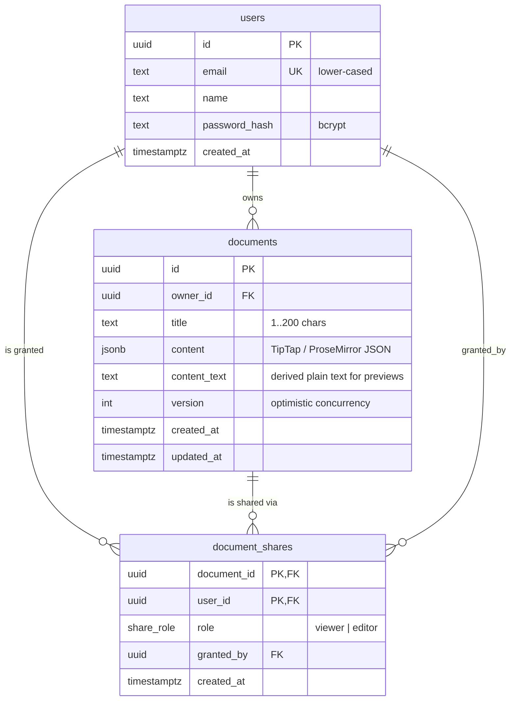

# 04 — Database Design

**Engine:** PostgreSQL 16. Production runs on **Neon (free tier)**. Local dev and tests run on **PGlite** (embedded Postgres). The schema and migrations are identical everywhere.
**Access layer:** Drizzle ORM. Migrations are generated by `drizzle-kit generate` into `apps/api/drizzle/*.sql` and committed.

---

## 1. Entity relationship



---

## 2. DDL (what the Drizzle schema generates)

```sql
CREATE TYPE share_role AS ENUM ('viewer', 'editor');

CREATE TABLE users (
  id            uuid PRIMARY KEY DEFAULT gen_random_uuid(),
  email         text NOT NULL UNIQUE,                -- stored lower-cased by the service
  name          text NOT NULL,
  password_hash text NOT NULL,
  created_at    timestamptz NOT NULL DEFAULT now()
);

CREATE TABLE documents (
  id           uuid PRIMARY KEY DEFAULT gen_random_uuid(),
  owner_id     uuid NOT NULL REFERENCES users(id) ON DELETE CASCADE,
  title        text NOT NULL DEFAULT 'Untitled document'
               CHECK (char_length(title) BETWEEN 1 AND 200),
  content      jsonb NOT NULL DEFAULT '{"type":"doc","content":[{"type":"paragraph"}]}',
  content_text text NOT NULL DEFAULT '',
  version      integer NOT NULL DEFAULT 1,
  created_at   timestamptz NOT NULL DEFAULT now(),
  updated_at   timestamptz NOT NULL DEFAULT now()
);
CREATE INDEX documents_owner_updated_idx ON documents (owner_id, updated_at DESC);

CREATE TABLE document_shares (
  document_id uuid NOT NULL REFERENCES documents(id) ON DELETE CASCADE,
  user_id     uuid NOT NULL REFERENCES users(id) ON DELETE CASCADE,
  role        share_role NOT NULL DEFAULT 'viewer',
  granted_by  uuid NOT NULL REFERENCES users(id) ON DELETE CASCADE,
  created_at  timestamptz NOT NULL DEFAULT now(),
  PRIMARY KEY (document_id, user_id)
);
CREATE INDEX document_shares_user_idx ON document_shares (user_id);
```

`gen_random_uuid()` is built into PostgreSQL 13+ (no extension needed) and is supported by PGlite.

### Design notes
| Decision | Reason |
|---|---|
| UUID primary keys | Ids are not enumerable in URLs (`/d/:id`), and they are safe to generate anywhere |
| Composite PK `(document_id, user_id)` | One share per user per document, so `PUT` is a natural upsert (`ON CONFLICT DO UPDATE SET role`) |
| Owner is **not** a row in `document_shares` | Ownership is a fixed property (`documents.owner_id`). Shares only grant extra access. This rules out states like "the owner revoked themselves". |
| `ON DELETE CASCADE` | Deleting a document removes its shares, and deleting a user removes their docs (no orphans) |
| `CHECK` on title length | The DB enforces the same rule as Zod (defense in depth) |
| `jsonb` content | Structure-preserving and queryable if needed later. Size is capped at 1 MB by the API. |
| `content_text` | Cheap list previews without sending content JSON to the dashboard. It could later back full-text search (`tsvector`). |
| `version` integer | Concurrency control (see Backend §5). Incremented only on content writes. |
| `updated_at` set by the service | Explicit `updated_at = now()` in each UPDATE (no trigger, so it behaves the same in PGlite and Neon) |

---

## 3. Core queries

**Dashboard list (`scope=all`)**: owned and shared docs in one round trip:
```sql
SELECT d.id, d.title, left(d.content_text, 160) AS preview, d.created_at, d.updated_at,
       CASE WHEN d.owner_id = $me THEN 'owner' ELSE s.role::text END AS role,
       u.id AS owner_id, u.name AS owner_name, u.email AS owner_email,
       (SELECT count(*) FROM document_shares x WHERE x.document_id = d.id) AS shared_with_count
FROM documents d
JOIN users u ON u.id = d.owner_id
LEFT JOIN document_shares s ON s.document_id = d.id AND s.user_id = $me
WHERE d.owner_id = $me OR s.user_id IS NOT NULL       -- scope=owned: d.owner_id = $me · scope=shared: s.user_id IS NOT NULL
ORDER BY d.updated_at DESC
LIMIT 200;
```

**Access check (load a document and the caller's role)**
```sql
SELECT d.*, s.role AS share_role
FROM documents d
LEFT JOIN document_shares s ON s.document_id = d.id AND s.user_id = $me
WHERE d.id = $id;
```

**Grant or change access**
```sql
INSERT INTO document_shares (document_id, user_id, role, granted_by)
VALUES ($doc, $user, $role, $me)
ON CONFLICT (document_id, user_id) DO UPDATE SET role = EXCLUDED.role;
```

---

## 4. Seed data (idempotent, runs at boot when `SEED_DEMO_DATA=true`)

| User | Email | Password | Purpose |
|---|---|---|---|
| Alice Chen | `alice@ajaia.test` | `demo1234` | Owns "Q4 Product Brief" (rich formatting sample), shared with Bob as **editor** |
| Bob Rivera | `bob@ajaia.test` | `demo1234` | Owns "Team Retro Notes", shared with Alice as **viewer** |
| Carol Singh | `carol@ajaia.test` | `demo1234` | Starts with nothing. Use her to test granting new access live. |

- Users are inserted with `ON CONFLICT (email) DO NOTHING`.
- Sample documents use **fixed UUIDs** with `ON CONFLICT (id) DO NOTHING`, so a redeploy never duplicates or overwrites reviewer edits.
- These are demo-only passwords. They are bcrypt-hashed in the DB and published in the README on purpose, so reviewers can log in.

---

## 5. Migrations workflow

```bash
# after editing apps/api/src/db/schema.ts
npm run db:generate -w @ajaia/api     # drizzle-kit generate → apps/api/drizzle/0001_*.sql
# applied automatically on server boot (dev, prod) and before tests (PGlite)
```
- Migration files are committed and reviewed like code.
- Forward-only. Destructive changes would need an expand/contract rollout (out of scope here).

## 6. Capacity sanity check (free tier)
- Neon free: about 0.5 GB of storage. A typical document is 5–50 KB of JSON, so tens of thousands of documents fit, far more than a review needs.
- Neon suspends compute after about 5 minutes idle, and its wake-up is around 1 s (much faster than Render's cold start). The pg Pool is set to `max: 5` and `idleTimeoutMillis: 30_000`, and connects through Neon's **pooled** connection string.

## 7. Future evolution (not now)
- `document_versions(document_id, version, content, created_by, created_at)` for version history
- `comments(document_id, anchor, body, author_id, resolved_at)` for commenting
- `tsvector` on `content_text` with a GIN index for search
- Soft delete (`deleted_at`) with a trash view
